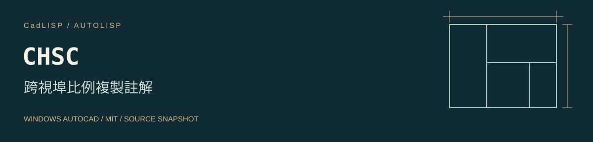

# CHSC 跨視埠比例複製註解



[工具儲存庫](https://github.com/whos-dwg/CadLISP-CHSC) · [全部工具索引](https://github.com/whos-dwg/CadLISP-Index)

依來源及目標視埠的 CustomScale 比值，在圖紙空間複製物件並換算位置及尺寸。

| 項目 | 內容 |
| --- | --- |
| 指令 | `CHSC` |
| 檔案 | [CHSC.lsp](lsp/CHSC.lsp) |
| 分類 | 配置與圖層 |
| 狀態 | 來源快照，實機回歸待完成 |
| 授權 | [MIT](LICENSE)，Copyright (c) 2026 whos-dwg |

[安裝](#安裝) · [操作](#操作) · [相依與設定](#相依與設定) · [已知問題](docs/KNOWN_ISSUES.md) · [驗證紀錄](docs/VALIDATION.md)

## 安裝

以 Windows 桌面版 AutoCAD 為目標。原碼使用的 Visual LISP／ActiveX、DCL 或原生命令，需在目標 AutoCAD 版本分別確認；尚未做整包年份、LT、Mac 或其他 CAD 的相容性認證。ActiveX 的平台限制見 [Autodesk](https://help.autodesk.com/cloudhelp/2026/ENU/AutoCAD-AutoLISP/files/GUID-A0459510-CE7A-4206-9EAA-E25AAB569B20.htm)。

1. 下載並解壓縮本工具到固定位置，先開啟測試圖面。
2. 依公司環境把 `lsp` 資料夾加入需要的支援搜尋路徑與受信任位置。
3. 輸入 `APPLOAD`，載入 `CHSC.lsp`；關閉視窗後輸入 `CHSC`。

也可使用完整路徑單獨載入；下列路徑需依實際位置修改：

```lisp
(load "C:/CAD/CadLISP-CHSC/lsp/CHSC.lsp")
```

完成驗證後，可將這支 LISP 加入 APPLOAD 的 Startup Suite。請維持既定的 SECURELOAD 政策，使用受信任位置處理載入限制。[SECURELOAD 說明](https://help.autodesk.com/cloudhelp/2026/ENU/AutoCAD-Core/files/GUID-541566C6-2738-49DD-87C3-C1490E924A02.htm)。

## 操作

1. 輸入 `CHSC`，依序選來源視埠與目標視埠，也可選視埠裁切邊界。
2. 選取本次要複製的圖紙空間物件並按 Enter。
3. 指定來源基準點與目標對應點，檢查複製後的文字、箭頭及引線接點。

## 相依與設定

在配置頁操作；來源及目標視埠必須位於目前配置，不能選紙空間總視埠。

圖面影響：建立副本；排除 VIEWPORT 本身。

## 行為與限制

倍率＝目標 CustomScale ÷ 來源 CustomScale。例如 1:100 轉 1:50 為 2。程式會嘗試恢復註解顯示尺寸；插入點偏離文字中心、引線與內容分離時仍可能需要手動校正。

## 來源與授權

本工具依維護者確認為自行從零撰寫，或以 AI 協作從零開發。程式與本次文件採 [MIT 授權](LICENSE)，允許使用、修改與再散布，須保留授權及著作權聲明。詳細來源紀錄見 [provenance.json](metadata/provenance.json)。

## 回報與維護

回報時附 AutoCAD 完整版本、命令列錯誤與去識別的重現範例。修改前請閱讀 [CONTRIBUTING](CONTRIBUTING.md)；發行步驟見 [PUBLISHING](docs/PUBLISHING.md)。本工具可獨立維護、下載及發布，不依賴其他 CadLISP 工具儲存庫。
